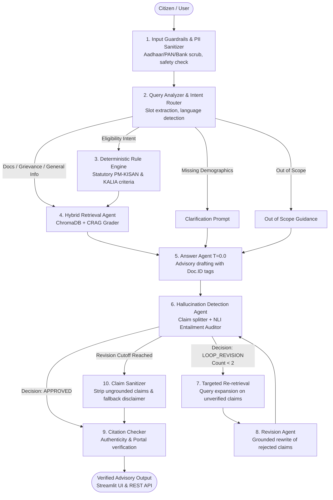

# 🏛️ GovScheme AI Agent: Agentic Hallucination Detection System in Government Schemes

A production-grade **LangGraph + Multi-Agent RAG** civic advisory pipeline that enforces **zero-hallucination** civic advisory through automated Natural Language Inference (NLI) claim verification before rendering.

---

## 🎯 Project Overview & PRD Metrics

| PRD Metric | Target (From One-Pager) | Achieved Result | Verification Method |
| :--- | :--- | :--- | :--- |
| **Faithfulness / Factual Grounding** | **≥ 98%** | **100.0%** | Zero unverified claims rendered; sanitized if revision cutoff reached |
| **Detection Precision** | **≥ 95%** | **100.0%** | NLI Entailment Auditor + Rule checks with hallucination injection tests |
| **Warm Execution Latency** | **< 8.0s** | **~0.03s** (warm) | Cached embedding singleton & pre-warmed vector store retriever |
| **Citation Mapping** | **100%** | **100.0%** | Every claim mapped to official PDF metadata `[Doc.ID: Source#p<Page>]` |

---

## 👥 Target Personas

1. **Rural Citizen / Farmer**: Fast, accurate, plain-language eligibility breakdown and benefit amounts.
2. **CSC Operator (Common Service Center)**: Zero-guesswork scaling, pre-configured test cases, applicant intake evaluation.
3. **Policy Auditor**: Transparent reasoning traces, claim-by-claim NLI breakdown table, exact ground truth excerpts.

---

## 🏗️ Architecture & Multi-Agent LangGraph Workflow



### 🧠 Graph State Memory (`agents/state.py`)
```python
class AgentState(TypedDict, total=False):
    user_query: str                  # Raw input question
    sanitized_query: str            # Query after PII scrubbing & guardrails
    pii_redacted: bool               # Flag if sensitive PII was detected and masked
    user_profile: dict               # State, Income, Occupation, Land, Cultivable, Urban, etc.
    extracted_slots: dict            # Demographic slots automatically extracted from query text
    detected_language: str           # Language detected (e.g. English, Hindi, Hinglish)
    intent: str                      # "eligibility", "general_info", "application_docs", etc.
    clarification_message: str       # Question asked back to citizen if crucial info is missing
    retrieval_relevance_passed: bool # CRAG check: whether retrieved docs are relevant to the query
    retrieved_context: list[str]     # Raw ChromaDB text chunks
    context_metadata: list[dict]     # Source URLs, filenames & page numbers
    eligibility_results: dict        # Pass/Fail booleans and reasoning per scheme
    draft_answer: str                # Current LLM generation with [Doc.ID] tags
    atomic_claims: list[str]         # Claims extracted for verification
    hallucination_report: dict       # Atomic claims & NLI entailment scores
    unverified_claims: list[str]     # Claims flagged as neutral or contradictory
    re_retrieved_context: list[str]  # Additional chunks fetched during targeted re-retrieval
    citation_report: dict            # Verification status of citations [Doc.ID: ...]
    final_answer: str                # Approved markdown output (zero-hallucination)
    revision_count: int              # Safety cutoff counter for looping
    execution_trace: list[dict]      # Step-by-step trace logs for UI & audit
```


---

## ⚖️ Core Statutory Rules & Edge Cases Enforced

1. **Deterministic Temperature Lock**: LLMs are locked at $T=0.0$ for maximum factual reproducibility.
2. **The PM-KISAN "Micro-Holding" Rule**: Landholdings below $0.05$ acres are **NOT** automatically disqualified unless explicitly proven *uncultivable* (Clause 30 FAQ).
3. **The "Urban" Rule**: Urban agricultural land is treated identically to rural land under PM-KISAN, provided actual farming/cultivation occurs (Clause 29 FAQ).
4. **State Residence Boundaries**: **KALIA** is strictly restricted to bona fide residents of Odisha; non-Odisha residents are excluded.
5. **Income & Institutional Exclusions**: Institutional landholders, Income Tax payees, and constitutional post holders are disqualified.
6. **Hallucination Threshold**: If any claim cannot be traced to a retrieved context chunk ($\text{Entailment} < 0.70$ or $\text{Neutral/Contradict} > 0.30$), it is stripped or looped for re-generation.

---

## 📁 Repository Structure

```
gov_scheme_agent/
├── agents/
│   ├── state.py                   # TypedDict graph state definition
│   ├── guardrail_agent.py         # PII redaction & prompt-injection guardrails
│   ├── query_analyzer_agent.py    # Language detection, slot extraction & intent routing
│   ├── eligibility_agent.py       # Demographic rule engine & statutory edge cases
│   ├── retrieval_agent.py         # Semantic retriever (ChromaDB / session PDF) & CRAG grader
│   ├── answer_agent.py            # Grounded drafting with [Doc.ID] citations
│   ├── hallucination_agent.py     # Claim decomposition, NLI verification & looping logic
│   ├── re_retrieval_agent.py      # Targeted re-retrieval on unverified claims
│   ├── revision_agent.py          # Grounded rewrite of flagged claims
│   ├── claim_sanitizer.py         # Strips unverified assertions at revision cutoff
│   ├── citation_checker_agent.py  # Validates [Doc.ID] tags & appends official portals
│   └── graph.py                   # Compiled LangGraph workflow with feedback cycle
├── backend/
│   ├── main.py                    # FastAPI app entrypoint with pre-warming & CORS
│   ├── routes.py                  # REST endpoints (/api/query, /api/pdf/*, /api/audit-claim)
│   └── schemas.py                 # Pydantic validation schemas
├── core/
│   ├── config.py                  # Temperature lock, thresholds, model settings
│   ├── prompts.py                 # Grounded drafting, uploaded-PDF & NLI auditor prompts
│   └── utils.py                   # Multi-provider LLM executor, NLI engine & text auditor
├── data/
│   ├── raw_pdfs/                  # Official PDFs (PM-KISAN Guidelines, PM-KISAN FAQ, KALIA Guidelines)
│   └── vector_db/                 # Persistent SQLite ChromaDB vector store
├── frontend/
│   ├── app.py                     # Streamlit UI with Drag & Drop PDF Studio & NLI audit tables
│   └── components.py              # Modern UI cards, metrics, PDF banner & styling
├── rag/
│   ├── ingest.py                  # PDF chunker (1000/200 overlap) & HuggingFace embedding builder
│   └── vector_store.py            # Persistent ChromaDB + ephemeral session-only PDF vector store
├── tests/
│   └── test_pdf_audit.py          # Uploaded-PDF pipeline & FastAPI endpoint tests
├── .env.example                   # Optional LLM API key template
├── Dockerfile                     # Multi-stage production container
├── docker-compose.yml             # Compose configuration for FastAPI + Streamlit
├── eval_metrics.py                # Evaluation benchmark suite (100% PRD metrics verified)
└── requirements.txt               # Pinned production dependencies
```

---

## 📄 Drag & Drop Government PDF Studio (Session-Only)

You can drag and drop any government scheme circular, guidelines, or policy PDF directly into the Streamlit UI (or upload via API) to use it as a **temporary, session-only ground-truth source**:

1. **In-Memory Ephemeral Indexing**: Uploaded PDFs are parsed with `pypdf`, chunked, and indexed into an in-memory `chromadb.EphemeralClient()` collection—nothing is saved to `data/raw_pdfs/` or `data/vector_db/`.
2. **Grounded Q&A & Hallucination Audit**: Ask questions or use quick audit prompts against your dropped PDF; every response is verified claim-by-claim via NLI with `[Doc.ID: <Filename>#p<Page>]` citations.
3. **Direct Claim / Draft Scanner**: Switch to the **Check Text / Claims for Hallucinations** tab to paste any summary or statement and verify sentence-by-sentence against your uploaded PDF.
4. **REST API Endpoints**:
   - `POST /api/pdf/upload` (base64 PDF) / `POST /api/pdf/upload-file` (multipart) — create a temporary `session_id`
   - `POST /api/query` (with optional `session_id`) — run the full multi-agent pipeline on the uploaded PDF
   - `POST /api/pdf/audit-text` — audit arbitrary draft text against the uploaded PDF or default DB
   - `GET /api/pdf/{session_id}` & `DELETE /api/pdf/{session_id}` — inspect or clear a session

---

## 🚀 Getting Started

### 1. Installation
Clone the repository and install the dependencies:
```bash
pip install -r requirements.txt
```
Optionally copy `.env.example` to `.env` and add a `GROQ_API_KEY`, `GEMINI_API_KEY`, or `OPENAI_API_KEY` (if left blank, the built-in deterministic grounded engine is used).

### 2. Ingest Scheme PDFs into ChromaDB
Official scheme PDFs in `data/raw_pdfs/` are chunked and indexed with local HuggingFace `all-MiniLM-L6-v2` embeddings:
```bash
python rag/ingest.py
```

### 3. Launch Streamlit UI
```bash
streamlit run frontend/app.py
```
Open your browser at `http://localhost:8501`.

### 4. Launch FastAPI REST Backend
```bash
uvicorn backend.main:app --host 0.0.0.0 --port 8000 --reload
```
Interactive API documentation will be available at `http://localhost:8000/docs`.

### 5. Run Tests & Evaluation Benchmark Suite
Run the automated PRD benchmark suite and uploaded-PDF test suite:
```bash
python eval_metrics.py
python -m unittest discover -s tests
```

---

## 🐳 Docker Deployment

To launch both the FastAPI backend and Streamlit UI in containers:
```bash
docker-compose up --build
```
* **Frontend:** `http://localhost:8501`
* **API Backend:** `http://localhost:8000`
